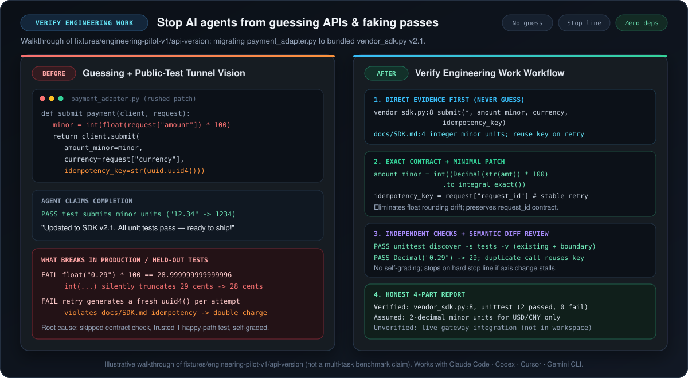

# Verify Engineering Work

[](https://github.com/0718lol/verify-engineering-work/actions/workflows/ci.yml)
[](LICENSE)

English | [简体中文](README.zh-CN.md)

**Stop AI coding agents from guessing APIs, looping on broken fixes, and grading their own homework.**

`Verify Engineering Work` is a zero-dependency reliability skill for **Claude Code, Codex CLI, Cursor, Gemini CLI**, and any agent supporting `SKILL.md`. It forces direct code/runtime evidence before edits, enforces a hard stop line when retries stall, separates execution from independent checks, and keeps reporting strictly honest.

Current version: `0.5.0`.

<p align="center">
  
</p>

---

## Why This Exists

Most failures in AI-assisted coding aren't "model intelligence" limits — they're predictable workflow failures:

- **Guessing unfamiliar or upgraded APIs** from stale training memory instead of inspecting installed source, lockfiles, or `--help` output.
- **Conflicting docs/examples** where comments say A while installed code does B — and the agent silently picks A.
- **Rushing past broken premises** (patching a non-existent bug or reinventing something already in the repo) or nagging on routine local edits.
- **Failure loops with no stop line** — burning context and mangling a working tree after repeated failed patches.
- **Self-grading bias** — writing a happy-path patch, passing one weak public test, and declaring `"All tests pass, ready to ship!"`.

## What the Skill Enforces

Read the full runtime skill in [SKILL.md](SKILL.md) (~100 lines, zero dependencies):

1. **Fast premise check & risk scaling** — Only pauses to challenge a task when direct evidence shows the premise is broken; routes local work into `Low / Medium / High` without seeking duplicate confirmation on normal local edits, while requiring explicit target authorization + rollback before external or production mutations.
2. **Evidence discipline (never guess)** — Any symbol, file path, flag, API signature, or runtime behavior not observed in the current session is unverified. Enforces authority order (**direct runtime & installed source > repo definitions > version-matched official docs**), flags source conflicts, treats inference as **not evidence**, and routes unknowns cleanly into *look up* / *ask product decision* / *abstain explicitly*.
3. **Minimal, intact edits** — Exact patches, no omission placeholders (`...`, `rest unchanged`), preserves unrelated changes, redacts secrets.
4. **Independent checks & anti-self-grading** — Treats deterministic external checks (existing suites, typecheckers, linters, CI, discriminating boundary tests) as the primary judge; supports isolated reviewer delegation on high-risk changes and explicitly bans fake single-context role-playing.
5. **Failure-loop axis change + hard stop line** — Tracks `hypothesis -> evidence -> change -> result`; forces an axis change after two materially similar failures and stops cleanly if a changed axis still stalls, a premise is disproven, or scope/authority is exceeded.
6. **4-part honest reporting** — Strictly separates **Verified** (machine/independent vs. self-checked), **Assumed / inferred**, **Skipped / unverified**, and **Blockers / limitations**.

---

## Install (1 Minute — No Docker Needed)

You only need `SKILL.md` and `references/` to use the Skill. The Docker/evaluation scripts in this repository are strictly for benchmarking.

### Clone directly into your agent's skills directory

```bash
# Claude Code
git clone https://github.com/0718lol/verify-engineering-work.git ~/.claude/skills/verify-engineering-work

# Codex CLI
git clone https://github.com/0718lol/verify-engineering-work.git ~/.codex/skills/verify-engineering-work

# Gemini CLI / Antigravity
git clone https://github.com/0718lol/verify-engineering-work.git ~/.gemini/config/skills/verify-engineering-work

# Cursor (project-local rule/skill copy)
git clone https://github.com/0718lol/verify-engineering-work.git .cursor/skills/verify-engineering-work
```

> **Cross-agent note:** The `SKILL.md` workflow itself is plain Markdown and works across `SKILL.md`-compatible agents. Automated implicit-trigger harnesses in `scripts/` and `agents/openai.yaml` currently target Codex CLI; if you benchmark implicit triggering on another runtime, adapt the trigger adapter and re-run trigger evaluation.

### Usage

Once installed, the skill triggers automatically on unfamiliar/version-sensitive APIs, conflicting docs, multi-module changes, security/privacy/migration/concurrency work, repeated failures, or explicit evidence requests — or invoke it directly:

```text
$verify-engineering-work Upgrade our payment adapter to the bundled SDK, verify edge cases and retry idempotency, and do not guess signatures.
```

```text
$verify-engineering-work 修复这个跨模块鉴权问题，先核验现有代码证据，验证兼容性和失败路径。
```

---

## Why This Isn't "Just Another Prompt Repo"

Most skill repositories publish rules with zero way to test whether they help or hurt. This repository ships a **reproducible, tamper-checked evaluation harness** alongside the Skill:

- **12 workflow behavior boundary cases** ([references/workflow-behavior-cases-v1.json](references/workflow-behavior-cases-v1.json)): checks authorization boundaries (local high-impact vs. external mutation), avoiding forced test churn, axis changes after repeated failures, and honest reporting of skipped checks.
- **Immutable paired engineering fixtures + held-out hidden tests**:
  - Pilot set ([references/engineering-task-pilot-v1.json](references/engineering-task-pilot-v1.json)): 8 distinct categories (`api-version`, `change-integrity`, `concurrency`, `migration`, `privacy`, `state-leak`, `contract`, `scope`), calibrated by CI (`scripts/calibrate_engineering_pilot.py`) so 4/8 public tests pass and 0/8 hidden tests pass at baseline.
  - Development probe set ([references/engineering-task-probe-v2.json](references/engineering-task-probe-v2.json)): 4 additional paired tasks (`allocation`, `profile-patch`, `webhook-retry`, `jsonl-contract`).
- **40-case boundary trigger benchmark** ([references/trigger-benchmark-v2.json](references/trigger-benchmark-v2.json)): interleaved English & Chinese positive/negative boundary prompts (negatives deliberately contain high-risk vocabulary like *production*, *migration*, *security* without requesting engineering execution).
- **Docker-isolated runner + statistical publication gates**: blind scoring ([references/eval-rubric.md](references/eval-rubric.md)), SHA-256 provenance manifests, Wilson intervals, deterministic paired-bootstrap deltas, and a hard non-overridable gate (`>= 40` matched pairs + `evaluator-external` held-out isolation) before `publication_ready` can become `true`.

### Honest Current Status

- **Verified**: repository integrity, 39 unit tests, immutable fixture calibration, isolated environment packaging, schema validation, and early Codex CLI trigger pilots (`8/8` on v0.2.0 in [evals/trigger-pilot-2026-07-17.json](evals/trigger-pilot-2026-07-17.json); `13/13` on v0.2.2 in [evals/trigger-pilot-2026-07-18-reclassified.json](evals/trigger-pilot-2026-07-18-reclassified.json)).
- **Not claimed**: we do **not** claim a percentage lift in engineering quality yet. The bundled 8-pair pilot is for calibration and failure discovery; statistically publishable effect sizes require `>= 40` matched pairs with externally isolated held-out tests.

---

## Reproducible Evaluation Details

<details>
<summary><strong>Paired Engineering Evaluation & Docker Isolation Commands</strong></summary>

### Local Pilot Pipeline

```bash
python3 scripts/prepare_paired_eval.py \
  references/engineering-task-pilot-v1.json \
  .eval/engineering-pilot-v1

python3 scripts/run_paired_eval.py \
  .eval/engineering-pilot-v1/paired-tasks.json \
  .eval/engineering-pilot-v1/paired-runs.json \
  --baseline-codex-home /path/to/baseline-codex-home \
  --skill-codex-home /path/to/skill-codex-home \
  --artifacts-dir .eval/engineering-pilot-v1/run-artifacts \
  --review-output .eval/engineering-pilot-v1/blind-review.json \
  --mapping-output .eval/engineering-pilot-v1/blind-mapping.json \
  --skill-commit "$(git rev-parse HEAD)" \
  --held-out-isolation pilot-local \
  --seed 20260718 \
  --max-total-tokens 2000000 \
  --allow-workspace-write

python3 scripts/verify_paired_eval.py \
  .eval/engineering-pilot-v1/paired-tasks.json \
  .eval/engineering-pilot-v1/paired-runs.json \
  .eval/engineering-pilot-v1/machine-results.json \
  --artifacts-dir .eval/engineering-pilot-v1/verification-artifacts \
  --allow-verification-commands

# After blind reviewers fill scores per references/blind-scores.example.json:
python3 scripts/build_scored_eval.py \
  .eval/engineering-pilot-v1/paired-runs.json \
  .eval/engineering-pilot-v1/blind-mapping.json \
  blind-scores.json scored-results.json \
  --machine-results .eval/engineering-pilot-v1/machine-results.json
python3 scripts/score_eval.py scored-results.json --minimum-pairs 8
```

### Docker-Isolated Runner (Codex CLI or Local Ollama)

The container mounts only the task workspace, controlled Codex home, and read-only auth file — `evaluation/hidden-tests` never enters the container:

```bash
docker build \
  --build-arg CODEX_VERSION=0.144.0-alpha.4 \
  --tag verify-engineering-work-codex:0.144.0-alpha.4 \
  --file docker/eval-runner.Dockerfile .

python3 scripts/create_controlled_codex_homes.py .eval/controlled-codex

CODEX_AUTH_FILE=/path/to/existing/auth.json \
python3 scripts/run_paired_eval.py \
  .eval/engineering-pilot-v1/paired-tasks.json \
  .eval/engineering-pilot-v1/paired-runs.json \
  --baseline-codex-home .eval/controlled-codex/baseline-home \
  --skill-codex-home .eval/controlled-codex/skill-home \
  --codex-executable "$PWD/scripts/codex_docker_wrapper.py" \
  --artifacts-dir .eval/engineering-pilot-v1/run-artifacts \
  --review-output .eval/engineering-pilot-v1/blind-review.json \
  --mapping-output .eval/engineering-pilot-v1/blind-mapping.json \
  --skill-commit "$(git rev-parse HEAD)" \
  --held-out-isolation evaluator-external \
  --allow-workspace-write
```

For local Ollama (no API key needed), pass `CODEX_LOCAL_PROVIDER=ollama` and `--model qwen2.5-coder:7b`. Manual task format reference: [references/paired-task-set.example.json](references/paired-task-set.example.json). JSON Schemas: [schemas](schemas).

</details>

<details>
<summary><strong>Implicit Trigger Benchmark & Compatibility Matrix</strong></summary>

Both [references/trigger-benchmark-v1.json](references/trigger-benchmark-v1.json) (40 balanced cases) and [references/trigger-benchmark-v2.json](references/trigger-benchmark-v2.json) (40 interleaved boundary cases) are supported with read-only execution, credential redaction, SHA-256 snapshots, checkpoint resume, and compatibility verification ([references/compatibility.json](references/compatibility.json)):

```bash
python3 scripts/run_trigger_eval.py \
  references/trigger-benchmark-v2.json trigger-observations.json \
  --codex-home "$CODEX_HOME" \
  --workspace /path/to/read-only-fixture \
  --model gpt-5.6-sol \
  --order stratified \
  --seed 20260718 \
  --snapshot-dir trigger-snapshot \
  --limit 8 \
  --max-total-tokens 500000 \
  --retries 1 \
  --logs-dir trigger-logs

python3 scripts/score_trigger_eval.py \
  references/trigger-benchmark-v2.json trigger-observations.json
```

See [README.zh-CN.md](README.zh-CN.md) for the complete Chinese evaluation protocol and historical pilot provenance.

</details>

---

## Local CI Checks

Python 3.12+ standard library only (zero third-party dependencies):

```bash
python3 -m compileall -q scripts tests fixtures evaluation
python3 -m unittest discover -s tests -p "test_*.py" -v
python3 scripts/score_eval.py --self-test
python3 scripts/calibrate_engineering_pilot.py references/engineering-task-pilot-v1.json --allow-verification-commands
python3 scripts/score_trigger_eval.py --self-test
python3 scripts/run_trigger_eval.py --self-test
python3 scripts/validate_repository.py
```

Key references: [SKILL.md](SKILL.md) · [references/risk-matrix.md](references/risk-matrix.md) · [references/evidence-report.md](references/evidence-report.md) · [references/eval-rubric.md](references/eval-rubric.md) · [VERSION](VERSION)

---

## Related Skills

- **[pr-test-receipt](https://github.com/0718lol/pr-test-receipt)** — Pre-PR verification skill that isolates committed `HEAD` on dirty checkouts, catches `0`-test false passes, and outputs a paste-ready PR Test Receipt.
- **[skill-slim](https://github.com/0718lol/skill-slim)** — Usage-based health check and slim-down for AI coding agent skills, rules, and plugins across Claude Code, Codex, Gemini CLI, and Cursor.
- **[scout-before-build](https://github.com/0718lol/scout-before-build)** — Research-first skill that scouts GitHub, product examples, and design references before building new projects.

## License

MIT — see [LICENSE](LICENSE).
