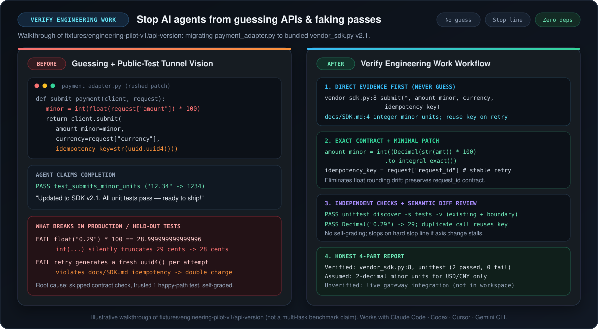

# Verify Engineering Work

[](https://github.com/0718lol/verify-engineering-work/actions/workflows/ci.yml)
[](LICENSE)

[English](README.md) | 简体中文

**让 AI 编程代理不再瞎猜 API、不再死循环瞎改、不再自己给自己发合格证。**

`Verify Engineering Work` 是一套零依赖的工程可靠性护栏，适用于 **Claude Code、Codex CLI、Cursor、Gemini CLI** 等支持 `SKILL.md` 的编程代理。它把“先查证再动手、定好停手线、拒绝自判、诚实汇报”固化为可执行的工程工作流，并配套完整的可复现隐藏测试与隔离评测框架。

当前版本：`0.5.0`。

<p align="center">
  
</p>

---

## 解决什么痛点

AI 写代码翻车，大多数时候不是模型“不够聪明”，而是几个反复出现的工作流坏习惯：

- **不知道就凭记忆瞎猜**：对陌生/升级后的 SDK、CLI 参数、配置项不查已安装源码或 `--help`，直接编造接口。
- **文档与代码打架时盲信过期注释**：README/示例说 A，真实代码跑的是 B，模型照着过期文档写。
- **前提错了还硬干，或反复试错停不下来**：连续失败多次还在原方向打补丁，把工作区改得面目全非。
- **自己写代码、自己写弱测试、自己宣布通过**：只过一个 happy-path 公开测试就宣称“已完成”，掩盖精度截断、重试重复扣费等隐患。

## 核心护栏（[SKILL.md](SKILL.md)，~100 行零依赖）

1. **开工前前提熔断 + 三档风险路由**：仅当直接证据表明任务前提不成立（Bug 无法复现、已有现成能力零改动可解、违反仓库硬约束）时才暂停质疑；明确本地修改直接执行，不重复确认；外部/生产变更必须拿到准确目标授权和回滚路径。
2. **反瞎猜证据纪律（Never Guess）**：当前会话未亲眼读过的符号、路径、参数、版本和运行结果一律视为未核验。按 **运行时与已安装源码 > 仓库定义 > 对应版本官方文档** 裁决冲突；明确 **推断不是证据**，未知项严格分流为「工具查证 / 询问产品决策 / 明确声明未知」。
3. **最小精确编辑**：使用精确补丁，严禁 `...` / `rest unchanged` 等省略占位符，保护无关修改并脱敏凭据。
4. **独立校验与反自判**：以确定性外部检查（既有测试、类型检查、Linter、CI、边界复现脚本）为主裁判；高风险且环境支持时用无执行历史的独立 reviewer/subagent 做对抗复核，严禁单上下文角色扮演“裁判”。
5. **失败换轴 + 硬停手线**：按 `hypothesis -> evidence -> change -> result` 记录，连续两次相似失败强制换轴；换轴仍无进展、核心前提证伪、越权或触达预设停手条件时立刻止损清理并交还证据。
6. **四分法诚实报告**：严格区分 **Verified（区分外部机器/独立验证与自查）**、**Assumed / inferred**、**Skipped / unverified**、**Blockers / limitations**。

---

## 1 分钟安装（使用 Skill 无需 Docker）

日常使用只需 `SKILL.md` 与 `references/`；仓库中的 Docker 和评测脚本仅用于做对照实验。

```bash
# Claude Code
git clone https://github.com/0718lol/verify-engineering-work.git ~/.claude/skills/verify-engineering-work

# Codex CLI
git clone https://github.com/0718lol/verify-engineering-work.git ~/.codex/skills/verify-engineering-work

# Gemini CLI / Antigravity
git clone https://github.com/0718lol/verify-engineering-work.git ~/.gemini/config/skills/verify-engineering-work

# Cursor（项目级目录）
git clone https://github.com/0718lol/verify-engineering-work.git .cursor/skills/verify-engineering-work
```

> **跨工具说明**：`SKILL.md` 本身是标准 Markdown，可在各类支持 Skills 的代理中直接复用。仓库中 `agents/openai.yaml` 和 `scripts/` 里的自动触发评测脚本目前针对 Codex CLI 编写；若在其他运行时做隐式触发评测，需适配触发检测器并重跑评测。

### 调用方式

安装后会在陌生/版本敏感 API、文档冲突、跨模块改动、安全/隐私/迁移/并发、重复失败或明确要求实证时自动触发，也可以主动调用：

```text
$verify-engineering-work 修复这个跨模块鉴权问题，先核验现有代码证据，验证兼容性和失败路径。
```

---

## 为什么不是“又一个纯 Prompt 仓库”

相比只给一页 prompt 却无法验证有效性的 Skill 仓库，本项目自带一套**防作弊、可复现的评测基础设施**：

- **12 个工作流行为边界场景**（[references/workflow-behavior-cases-v1.json](references/workflow-behavior-cases-v1.json)）：覆盖本地高影响与外部写入授权区分、避免强行改测试、失败换轴与未执行检查的诚实汇报。
- **不可变工程夹具 + held-out 隐藏测试**：
  - Pilot 任务集（[references/engineering-task-pilot-v1.json](references/engineering-task-pilot-v1.json)）：覆盖版本敏感 API、变更完整性、并发幂等、数据迁移、隐私脱敏、状态泄漏、滚动契约和跨模块配置 8 个类别；CI 通过 `scripts/calibrate_engineering_pilot.py` 锁定基线（4/8 公开测试通过，0/8 隐藏测试通过）。
  - 开发探针任务集（[references/engineering-task-probe-v2.json](references/engineering-task-probe-v2.json)）：包含 `allocation`、`profile-patch`、`webhook-retry`、`jsonl-contract` 4 个配对任务。
- **40 条边界触发基准**（[references/trigger-benchmark-v2.json](references/trigger-benchmark-v2.json)）：正负样本交替，负样本故意包含“生产、安全、迁移”等高危词汇但仅要求解释或只读审阅。
- **Docker 隔离运行器 + 统计学发布门禁**：盲评分（[references/eval-rubric.md](references/eval-rubric.md)）、SHA-256 来源清单、Wilson 区间与成对 Bootstrap，硬性要求至少 40 对样本且 held-out 测试外部隔离才会输出 `publication_ready: true`。

### 当前状态（诚实边界）

- **已验证**：仓库完整性校验、39 个单元测试、不可变夹具基线校准、隔离环境打包、JSON Schema（[schemas](schemas)），以及 Codex CLI 早期触发 Pilot（v0.2.0 `8/8` 见 [evals/trigger-pilot-2026-07-17.json](evals/trigger-pilot-2026-07-17.json)，v0.2.2 `13/13` 见 [evals/trigger-pilot-2026-07-18-reclassified.json](evals/trigger-pilot-2026-07-18-reclassified.json)）。
- **未宣称**：目前不承诺具体质量提升百分比；内置 8 对工程任务仅用于 Pilot 校准与问题发现，真实效果结论需在 `>= 40` 对外部隔离实验完成后才能给出。

---

## 可验证假设与评测命令

<details>
<summary><strong>查看完整配对评测、Docker 隔离与触发评测命令</strong></summary>

### 可验证假设

| 假设 | 主要指标 | 可能代价 |
|---|---|---|
| 减少未经核实的 API 与参数 | 虚构接口严重错误率 | 更多文档和源码查询 |
| 减少占位符和无关覆盖 | 变更完整性得分 | 更长的编辑与 diff 检查时间 |
| 提高风险匹配的验证深度 | 生产合规通过率 | Token、耗时和测试调用增加 |
| 减少重复无效调试 | 相似失败重复率、人工干预次数 | 第三次尝试前增加诊断成本 |
| 提高报告可信度 | 未验证即宣称完成的发生率 | 最终报告略长 |

### 配对工程评测（Pilot）

```bash
python3 scripts/prepare_paired_eval.py \
  references/engineering-task-pilot-v1.json \
  .eval/engineering-pilot-v1

python3 scripts/run_paired_eval.py \
  .eval/engineering-pilot-v1/paired-tasks.json \
  .eval/engineering-pilot-v1/paired-runs.json \
  --baseline-codex-home /path/to/baseline-codex-home \
  --skill-codex-home /path/to/skill-codex-home \
  --artifacts-dir .eval/engineering-pilot-v1/run-artifacts \
  --review-output .eval/engineering-pilot-v1/blind-review.json \
  --mapping-output .eval/engineering-pilot-v1/blind-mapping.json \
  --skill-commit "$(git rev-parse HEAD)" \
  --held-out-isolation pilot-local \
  --seed 20260718 \
  --max-total-tokens 2000000 \
  --allow-workspace-write

python3 scripts/verify_paired_eval.py \
  .eval/engineering-pilot-v1/paired-tasks.json \
  .eval/engineering-pilot-v1/paired-runs.json \
  .eval/engineering-pilot-v1/machine-results.json \
  --artifacts-dir .eval/engineering-pilot-v1/verification-artifacts \
  --allow-verification-commands

# 盲评者参考 references/blind-scores.example.json 填写评分后：
python3 scripts/build_scored_eval.py \
  .eval/engineering-pilot-v1/paired-runs.json \
  .eval/engineering-pilot-v1/blind-mapping.json \
  blind-scores.json scored-results.json \
  --machine-results .eval/engineering-pilot-v1/machine-results.json
python3 scripts/score_eval.py scored-results.json --minimum-pairs 8
```

### Docker 隔离评测（支持 Codex API 与本地 Ollama）

代理容器仅挂载当前任务工作区、受控 Codex Home 和只读认证文件，`evaluation/hidden-tests` 不会进入容器：

```bash
docker build \
  --build-arg CODEX_VERSION=0.144.0-alpha.4 \
  --tag verify-engineering-work-codex:0.144.0-alpha.4 \
  --file docker/eval-runner.Dockerfile .

python3 scripts/create_controlled_codex_homes.py .eval/controlled-codex

CODEX_AUTH_FILE=/path/to/existing/auth.json \
python3 scripts/run_paired_eval.py \
  .eval/engineering-pilot-v1/paired-tasks.json \
  .eval/engineering-pilot-v1/paired-runs.json \
  --baseline-codex-home .eval/controlled-codex/baseline-home \
  --skill-codex-home .eval/controlled-codex/skill-home \
  --codex-executable "$PWD/scripts/codex_docker_wrapper.py" \
  --artifacts-dir .eval/engineering-pilot-v1/run-artifacts \
  --review-output .eval/engineering-pilot-v1/blind-review.json \
  --mapping-output .eval/engineering-pilot-v1/blind-mapping.json \
  --skill-commit "$(git rev-parse HEAD)" \
  --held-out-isolation evaluator-external \
  --allow-workspace-write
```

使用宿主机 Ollama 时可设置 `CODEX_LOCAL_PROVIDER=ollama` 并通过 `--model qwen2.5-coder:7b` 指定本地模型。手工任务集格式见 [references/paired-task-set.example.json](references/paired-task-set.example.json)。

### 隐式触发评测

基准集见 [references/trigger-benchmark-v1.json](references/trigger-benchmark-v1.json) 和 [references/trigger-benchmark-v2.json](references/trigger-benchmark-v2.json)，兼容矩阵见 [references/compatibility.json](references/compatibility.json)：

```bash
python3 scripts/run_trigger_eval.py \
  references/trigger-benchmark-v2.json trigger-observations.json \
  --codex-home "$CODEX_HOME" \
  --workspace /path/to/read-only-fixture \
  --model gpt-5.6-sol \
  --order stratified \
  --seed 20260718 \
  --snapshot-dir trigger-snapshot \
  --limit 8 \
  --max-total-tokens 500000 \
  --retries 1 \
  --logs-dir trigger-logs

python3 scripts/score_trigger_eval.py \
  references/trigger-benchmark-v2.json trigger-observations.json
```

</details>

---

## 持续集成校验

仅使用 Python 3.12+ 标准库：

```bash
python3 -m compileall -q scripts tests fixtures evaluation
python3 -m unittest discover -s tests -p "test_*.py" -v
python3 scripts/score_eval.py --self-test
python3 scripts/calibrate_engineering_pilot.py references/engineering-task-pilot-v1.json --allow-verification-commands
python3 scripts/score_trigger_eval.py --self-test
python3 scripts/run_trigger_eval.py --self-test
python3 scripts/validate_repository.py
```

关键文档：[SKILL.md](SKILL.md) · [references/risk-matrix.md](references/risk-matrix.md) · [references/evidence-report.md](references/evidence-report.md) · [references/eval-rubric.md](references/eval-rubric.md) · [VERSION](VERSION)

---

## 相关技能

- **[pr-test-receipt](https://github.com/0718lol/pr-test-receipt)** — 发 PR 前轻量验货工具：对比分支 diff、在脏工作区时用临时 `git worktree` 隔离验证已提交 `HEAD`、拦截 `0`-test 假绿，并生成可直接贴进 GitHub/GitLab 的测试回执。
- **[skill-slim](https://github.com/0718lol/skill-slim)** — 跨 Claude Code / Codex / Gemini CLI / Cursor 审计常驻技能 token 成本并安全隔离冗余技能。
- **[scout-before-build](https://github.com/0718lol/scout-before-build)** — 动工前自动调研 GitHub 同类项目与设计参考的探路技能。

## 许可证

MIT，见 [LICENSE](LICENSE)。
